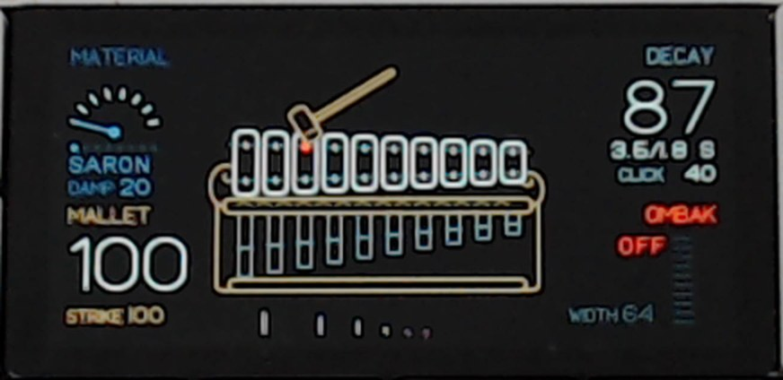
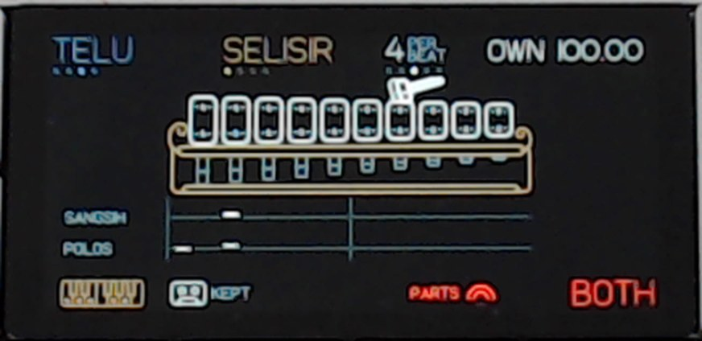

# gangsa and kotekan

Two [open-field](https://github.com/LaP0573/open-field) packs for the OP-1 Field on OS 1.7.3: **gangsa, a synth engine of struck metal and wood, and kotekan, a sequencer that weaves the two interlocking parts of Balinese kotekan around a key you hold.**

They belong together: kotekan is made to play gangsa's sounds. Each also works alone. gangsa plays from the keys like any engine, and kotekan only makes notes, so it drives any synth sound. Neither changes a place of the firmware. The full guides are [docs/gangsa.md](docs/gangsa.md) and [docs/kotekan.md](docs/kotekan.md).

## gangsa

An [open-field](https://github.com/LaP0573/open-field) pack for the OP-1 Field on OS 1.7.3: **a synth engine of struck metal and wood: gamelan bars and gongs, kalimba, bells and bowls, with ten sounds.**



*The engine's page (T1) with the `saron` sound: the material on a dial at the left, mallet 100, the bars with the mallet over them, decay 87 with the ring time under it (3.5 s held, 1.8 s after key-up), ombak off.*

Each voice is a bank of up to six sine partials of a material, each dying away at its own rate. A strike adds to a ringing bar and keeps its phases, so a bar struck again does not click. A short mallet click sits on the strike. A second, detuned bank gives the ombak, the beating shimmer of a gamelan pair, and can be spread from left to right. You get eight materials, eight values on the knobs, a drawn page and ten sounds; the engine is stereo and plays up to six voices.

### Listen

| Recording | What it shows |
| --- | --- |
| [The ten sounds](media/gangsa-01-the-ten-sounds.mp3) | gambang, mbira, saron, bonang, pair, gender, kempul, bell, bowl, gong, each with a short figure |
| [Gamelan in slendro](media/gangsa-02-gamelan-in-slendro.mp3) | Layers: saron (the tune), bonang, gender, kempul, gong, with the `tuning` pack on gamelan / slendro. The unit plays one synth sound at a time, so each part was played alone and the takes were summed on a computer |
| [Gong, bowl and bell in pelog](media/gangsa-03-gong-bowl-bell-in-pelog.mp3) | Layers, made the same way: gong, bowl, bell, pair, slow, with the `tuning` pack on gamelan / pelog |

Played over MIDI by a script and recorded from the unit's own USB audio; only the level was changed. They also play in the browser on [the packs page](https://hooligan333.github.io/open-field-packs/#gangsa).

### Use

1. On a synth sound, hold **shift** and press **T1**, then pick `gangsa`. The list is sorted by name, so it comes after `fm`. Or load one of its ten sounds from the folder `gangsa` in the sound list (see [Install](#install)).
2. Play. A held key rings for the `decay` time; after key-up `damp` shortens the ring. Harder notes are brighter, with a louder click. Loudness, the envelope and pan are the unit's own, as for every engine.
3. Press **T1** for the page.

| Knob | Value | What it does |
| --- | --- | --- |
| blue | `material` | The instrument, 0 to 7: saron, gender, bonang, gong, gambang, mbira, bell, bowl. Taken at each strike |
| second | `mallet` | Soft (duller) to hard (brighter) |
| third | `decay` | Ring time of a held note, 80 ms to 20 s |
| red | `ombak` | 0 is off; 1 to 127 is the pair's beat, 0.5 to 10 Hz |
| shift + blue | `damp` | How much faster the ring dies after key-up |
| shift + second | `strike` | Where the mallet hits, from the centre (hollow) to the edge |
| shift + third | `click` | Level of the mallet's click |
| shift + red | `width` | Stereo spread of the pair; heard only with ombak on |

### Status

**Tried on a unit** on 2026-11-25, version 6: OS 1.7.3, open-field 0.19 (base 37); it also starts on open-field 0.21 (base 39). The tests were run by remote control over USB: keys and knobs sent as MIDI, the unit's log, its USB audio, and a webcam on the screen.

- It starts beside 15 other packs, its picture is made, and the log holds no trouble line.
- Each of the ten sounds was sent to a synth slot as the pack's own file and played at C4, held for 1 s and let go. The long sounds ring on after key-up, in the designed order: `gong` is 40 dB down after 7.9 s, `saron` after 1.0 s, `mbira` after 0.5 s, and `gambang` is silent before key-up. Peaks lie between -22.2 and -24.6 dBFS, left and right are level, and no sample clipped.
- The base did not switch the engine off.
- The page is drawn: the material dial, the bars and the mallet, the ring time `3.5/1.8 s`.

**Not tried**: the sounds picked from the unit's own sound list, the same key struck ten times, `damp`, a seventh and eighth voice, six-note chords. The tests judged nothing by ear: the recordings were checked by level, length and pitch.

### Limits

- Up to six voices. Another note on a voice that still rings replaces the ring; the same note struck again adds to it.
- Cost: it declares 40,000 cycles a voice, the most open-field allows. On the unit one voice's worst render took 53,020, measured while the unit streamed USB audio, which makes single renders larger. Six-note chords were not measured.
- Its sounds are quieter than stock sounds: they peak at -22 to -25 dBFS at C4, where three stock sounds measured the same day peak at -13 to -17.5 dBFS.
- The page shows the values as set: an LFO that moves a value does not move its number.
- Many of the materials' numbers are estimates, not measurements of instruments. The mbira's buzz, the gong's swell and pitch glide, and the bonang's rim beating are not modelled.
- The ombak is a constant number of Hz at the fundamental, whatever the pitch; real pairs beat faster higher up. At width 127 each side alone is off pitch by half the beat.

## kotekan

An [open-field](https://github.com/LaP0573/open-field) pack for the OP-1 Field on OS 1.7.3: **a sequencer for the synth: hold one key and it weaves the two interlocking parts of Balinese kotekan around it.**



*The sequencer's page while a figure plays: style `telu`, map `selisir`, 4 steps a beat, the unit's own clock at 100. The two lanes show the notes of sangsih (above) and polos (below), and the picture of a gangsa shows the key being struck.*

The key you hold is the pokok. Around it kotekan plays polos, the lower part, and sangsih, the upper part, in one of four styles: nyog cag, norot, telu and empat. Move to another key and the figure keeps its beat, heads for the new tone and reaches it at the start of its next cycle. It counts in a map of five keys to the octave, runs at 2 to 8 steps to the tape's beat, and sends its notes to the synth and over MIDI. Its four settings are kept with the tape.

### Use

1. On the synth, open the list of sequencers and pick `kotekan`. Pack rows come after the unit's seven. The sequencer key switches it on and off.
2. **Hold a key.** It is the pokok, snapped to the nearest of the map's five keys. The figure starts at the next step.
3. **Move to another key.** The new tone arrives at the start of the figure's next cycle, which falls on a beat (at 8 steps a beat, on a beat or its half). Press the key early in the cycle, so the style can head for it.
4. **Let go of every key.** Every note ends at once.

| Knob | Setting | Values |
| --- | --- | --- |
| blue | STYLE | nyog cag, norot, telu, empat |
| ochre (second) | MAP | selisir `c d e g a`, tembung `f g a c d`, sunaren `g a b d e`, black keys |
| grey (third) | RATE | 2, 3, 4, 6 or 8 steps to the tape's beat |
| red (fourth) | PARTS | both, polos only, sangsih only, both + pokok (the pokok struck an octave below at the start of each cycle) |

With the `tuning` pack on gamelan / pelog the first three maps are the pelog modes selisir, tembung and sunaren, and on a slendro tuning a map gives slendro's five tones. With no tuning the maps are pentatonic scales. The table of maps and tunings is in [the guide](docs/kotekan.md#maps-tunings-and-sounds).

### Status

**Tried on a unit** on 2026-11-25: OS 1.7.3, open-field 0.19 (base 37); it also starts on open-field 0.21 (base 39). The tests were run by remote control over USB: keys and knobs sent as MIDI, the unit's log, its USB audio, and a webcam on the screen.

- Version 2, whose note code is version 3's: picked from the sequencer list, with another sequencer pack on the unit too. The page is drawn, also with `+POKOK`. All four styles ran: every note was one of the map's five tones and on the step grid, none was refused, none came late, and the synth was silent when the keys were let go.
- Version 3, which changes the page's texts only: it starts beside 15 other packs with no trouble line in the log, and `HOLD A KEY: THE POKOK`, `OFF: SEQ KEY STARTS IT`, `OWN 100.00` and `TAPE 100.00` stand whole on the screen.

**Not tried**: the figures step for step against the tables in the guide (on a unit that depends on when each key is pressed). The tests judged nothing by ear.

### Limits

- Synth only. It does not run while the unit is on the drum.
- The telu and empat tables come from a published source; the nyog cag and norot rows are reconstructions, and how a style heads for a new tone is a design choice. No gamelan player has checked any of it. Ubit-ubitan, angsel breaks and the cross-rhythm variants are not there.
- The settings are kept with the tape, not with the synth sound.
- The steps follow the firmware's beat count, which starts where play is pressed. Started in the middle of a beat, every step is off the metronome's click by that much; the stock sequencers are no different.
- Switched on while the tape already plays, its cycles may start on the off-eighth until play is pressed again.
- The octave keys move only keys pressed afterwards, not the figure already playing.
- With both + pokok, a figure note that is the very note the pokok rings on is not struck again: that step is silent.

## Install

Tick it on open-field's install page once it is listed there, or copy `gangsa.pack`, `kotekan.pack` or both into the unit's `packs` folder in disk mode and restart.

If the unit does not start with it, hold the **help** key while switching on: it then starts with no packs, and you can delete the file in disk mode.

gangsa's ten sounds reach the sound list in two starts. At the first start with the pack, open-field's base writes them into the unit's sound list, in a folder `gangsa`. The folder shows after the next start, so restart once more to find them. The engine itself is in the engine list (**shift** + **T1**) from the first start. kotekan needs nothing beside its file.

## Files

| File | What |
| --- | --- |
| `gangsa.pack` | The gangsa pack, version 6 |
| `kotekan.pack` | The kotekan pack, version 3 |
| `source/gangsa/` | gangsa's source: the sound code (`gangsa_core.h`), the pack (`gangsa.cpp`), `recipe.json`, the page's picture and the ten sound files |
| `source/kotekan/` | kotekan's source: the figures and the player (`kotekan_core.h`), the pack (`kotekan.cpp`), `recipe.json` and the page's picture |
| [docs/gangsa.md](docs/gangsa.md) | gangsa's guide: the values, the materials, the sounds, the page, the measurements |
| [docs/kotekan.md](docs/kotekan.md) | kotekan's guide: playing it, the styles note by note, the maps, the clock |
| [media/gangsa-saron.jpg](media/gangsa-saron.jpg), [media/gangsa-gong.jpg](media/gangsa-gong.jpg) | Photos of gangsa's page on the unit's screen, with the `saron` and the `gong` sound |
| [media/kotekan-page.jpg](media/kotekan-page.jpg), [media/kotekan-telu-playing.jpg](media/kotekan-telu-playing.jpg) | Photos of kotekan's page, waiting for a key and playing |
| `media/gangsa-01-the-ten-sounds.mp3`, `media/gangsa-02-gamelan-in-slendro.mp3`, `media/gangsa-03-gong-bowl-bell-in-pelog.mp3` | gangsa's recordings |
| `LICENSE` | The MIT licence |

## Build

Copy `source/gangsa/` into an open-field tree as `examples/gangsa/`, or `source/kotekan/` as `examples/kotekan/`, then:

```bash
python -I tools/pack_build.py build3 --recipe examples/gangsa/recipe.json --profile profiles/op1f-1.7.3.json --out out/gangsa.pack
python -I tools/pack_build.py build3 --recipe examples/kotekan/recipe.json --profile profiles/op1f-1.7.3.json --out out/kotekan.pack
```

Built this way against open-field 0.21, each comes out byte for byte as the file here.

## Sources and thanks

- kotekan's telu and empat tables come from Wikipedia's article "Kotekan", which derives them from Vitale (1990, *Balungan* 4(2)). The rules of all four styles come from Vitale. The three pelog modes of the maps are from Wikipedia's article "Pelog". The reconstructed rows and the moves between tones are this pack's own, and so are their mistakes.
- gangsa's partial ratios for bars, tines and the bell follow the textbook theory of struck bars and bell tuning. The other ratios, the weights and the decays are estimates.
- Thanks to the open-field project, on which both packs stand.

Unofficial; not made, endorsed or supported by Teenage Engineering. MIT licence.
