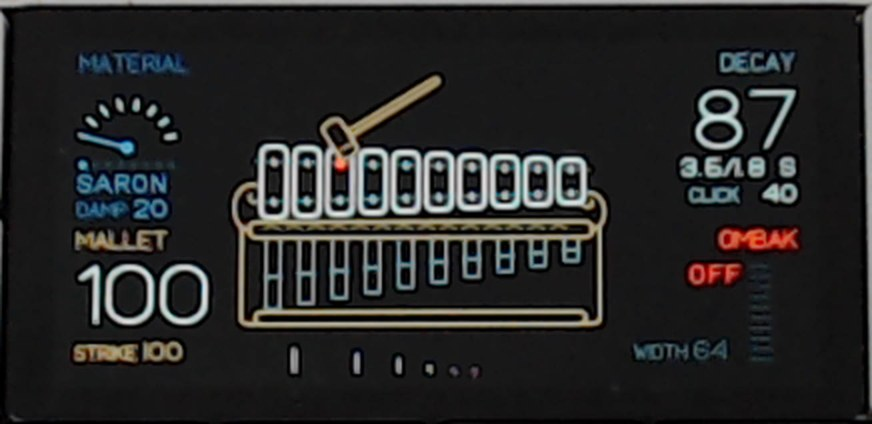
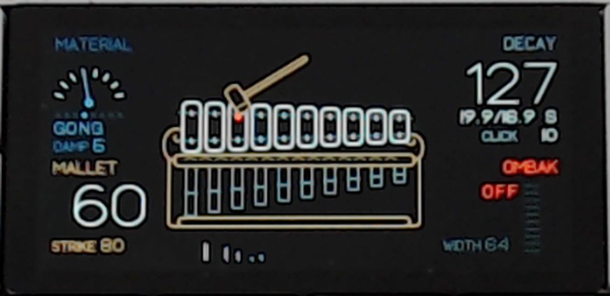

# gangsa: the guide

A synth engine pack for the OP-1 Field: struck metal and wood. It covers gamelan bars and gongs, kalimba, bells and
bowls. It is a level-9 pack for [open-field](https://github.com/LaP0573/open-field) on OS 1.7.3 and needs open-field
0.12 (base 30) or newer. This guide is for version 6. What was tried on a unit is under
[On the unit](#on-the-unit); the short version is in [the README](../README.md).

*The page (T1) with the `saron` sound, the engine's start values. A photo of the unit's screen.*

Each voice is a bank of up to six sine partials ("modes") of a material. Each partial decays exponentially at its own
rate. A strike adds energy to the partials and keeps their phases, so a ringing bar struck again does not click. A
short mallet click of filtered noise sits on the strike. A second, detuned bank (the twin) gives the **ombak**, the
beating shimmer of a gamelan pair, and can be spread from left to right. The engine is stereo.

On the unit: on a synth sound, hold **shift** and press **T1**, then pick `gangsa`. The list is sorted by name, so it
comes after `fm` (and after `fold`, if open-field's example pack of that name is there). Its ten sounds are in the
sound list in a folder `gangsa`, which shows after the next start: the base writes the sound files the first time the
pack runs, and the unit lists the folder from the start after that.

## The eight values

| Knob | Value | Range (start) | What it does to the sound |
| --- | --- | --- | --- |
| blue | `material` | 0-7 (0 saron) | Which instrument: the partials' ratios, weights and decay rule, and the click's colour. Taken at each strike: turning it while a note rings changes the next strike, not the ring |
| second | `mallet` | 0-127 (100) | Soft to hard. Soft (0) tilts the strike down by 6 dB an octave over the partials, so it is duller. Hard (127) strikes every partial at its full weight, with a brighter click |
| third | `decay` | 0-127 (87) | Ring time of the fundamental: 80 ms at 0, 3.5 s at 87, 20 s at 127. Upper partials die sooner, by the material's own rule |
| red | `ombak` | 0-127 (0) | 0 is off. 1-127 is the twin bank's beat at the fundamental: 0.5 Hz to 10 Hz. Upper partials beat faster, as real pairs do |
| shift + blue | `damp` | 0-127 (20) | Key-up damping: how much faster the ring dies after you let go. 0 rings on (until the unit's own envelope ends the voice), 127 is 64 times faster. A tapped key is let go almost at once, so it rings for the damped time, not the held one |
| shift + second | `strike` | 0-127 (100) | Where the mallet hits (a place, not a force), from the centre (0: the even modes vanish, hollow) to the edge (127: all modes) |
| shift + third | `click` | 0-127 (40) | Level of the mallet's noise click, a few ms long |
| shift + red | `width` | 0-127 (64) | Stereo spread of the pair. 0: both banks in the centre, each at half, so they beat in mono (on average 3 dB under ombak off: kept for headroom, as the two banks in phase reach the level of one). 127: main bank left, twin right, so the beat is between your ears. Only heard with ombak on; the page dims it while ombak is 0 |

**Velocity** changes the timbre only: harder notes are brighter (a partial an octave or more above the fundamental
moves 10 dB or more from velocity 10 to 127), with a louder click. Loudness, the envelope and pan are the unit's own,
as for every engine.

The materials' levels are evened out: each sound, one voice at velocity 127, is within 2 dB of the saron over its
first 100 ms, and peaks at -6 to -10 dBFS. These are the engine's own figures, before the unit's envelope and volume;
what the unit puts out is under [On the unit](#on-the-unit).

## The materials

| # | Name | What it is |
| --- | --- | --- |
| 0 | `saron` | Bronze bar (saron, gangsa): free-bar partials 1, 2.76, 5.40 ... with a bright click |
| 1 | `gender` | Bar over a tuned resonator: a strong, long fundamental with a slow beat of its own, a soft click |
| 2 | `bonang` | Kettle gong: partials 1, 1.5, 2, 2.7 ... |
| 3 | `gong` | Big hanging gong: low, long, with its own slow inner beating (0.4 Hz at 62 Hz) |
| 4 | `gambang` | Wooden bars: short and dull, the loudest click |
| 5 | `mbira` | Kalimba or mbira tine: 1, 6.27, 17.6 ... |
| 6 | `bell` | Church bell: prime, tierce, quint, nominal and upper third, with a soft hum an octave below |
| 7 | `bowl` | Singing bowl or glass: split partial pairs that shimmer |

Where the numbers come from: the ratios of the free bar (`saron`, `gender`), of the clamped tine (`mbira`) and of the
church bell's tuning follow the textbook theory. The ratios of the gong, the bonang and the bowl, the upper partials
of the `gambang`, and every weight, decay and ring time are estimates or design choices: none was measured on an
instrument. The whole table is `GS_MAT` in `source/gangsa/gangsa_core.h`. The mbira's buzz, the gong's swell and pitch
glide, and the bonang's rim beating are not modelled.

## The sounds

All ten use the unit's envelope with an instant attack, full sustain and a release that outlasts the ring, so that
the ring and the key-up damping are the engine's own. No effect and no LFO are on. The ten files are
`source/gangsa/saron.json` and its nine neighbours; `saron` holds the engine's start values.

Two things about the unit's sound files were learned on the way, and the files follow them since version 5. In the
unit a larger release number is a *shorter* release. The eighth envelope number is the sound's volume; it is set so
that the sounds have the loudness of the sounds of open-field's example engine `pluck`.

| Sound | Values (material, mallet, decay, ombak, damp, strike, click, width) | Octave | Ring held / tapped (engine alone) | Tapped, with the unit's release (computed) |
| --- | --- | --- | --- | --- |
| `saron` | 0, 100, 87, 0, 20, 100, 40, 64 | 0 | 3.5 s / 1.8 s | 1.45 s |
| `gender` | 1, 70, 100, 0, 15, 90, 10, 64 | 0 | 6.2 s / 3.8 s | 3.1 s |
| `bonang` | 2, 80, 92, 0, 20, 90, 30, 64 | 0 | 4.4 s / 2.3 s | 1.85 s |
| `gong` | 3, 60, 127, 0, 5, 80, 10, 64 | -2 | 20 s / 17 s | 10 s |
| `kempul` | 3, 70, 108, 0, 5, 80, 20, 64 | -1 | 8.8 s / 7.4 s | 5.7 s |
| `gambang` | 4, 95, 45, 0, 40, 100, 80, 64 | 0 | 0.56 s / 0.15 s | 0.12 s |
| `mbira` | 5, 95, 80, 0, 30, 110, 60, 64 | 0 | 2.6 s / 1.0 s | 0.8 s |
| `bell` | 6, 105, 115, 0, 5, 100, 40, 64 | 0 | 12 s / 10 s | 7.1 s |
| `bowl` | 7, 70, 122, 0, 5, 90, 15, 64 | -1 | 16 s / 14 s | 9.0 s |
| `pair` | 0, 100, 95, 87, 20, 100, 40, 127: strong ombak (7 Hz), wide | 0 | 5.0 s / 2.6 s | 2.1 s |

The ring is the fundamental's T60 (down 60 dB): held while the key is down, tapped once it is let go at once. Upper
partials die sooner. **After key-up the unit's own release always fades the voice as well**, and its longest is
24.8 s: the last column is the two together. Each sound's release is at least four times its tapped ring (`gong`,
`kempul`, `bell` and `bowl` at the unit's longest). A held key rings as the engine alone does. These columns are
worked out on a computer; the times measured on a unit are under [On the unit](#on-the-unit).

## Ombak and the tuning pack

The unit hands the engine its pitch already retuned. So if a pack that retunes the unit, such as the `tuning` pack, is
set to a slendro or pelog tuning, gangsa plays in it with nothing to set here. Two of the recordings in `media/` were
made that way: [gamelan in slendro](../media/gangsa-02-gamelan-in-slendro.mp3) and
[gong, bowl and bell in pelog](../media/gangsa-03-gong-bowl-bell-in-pelog.mp3).

The ombak is a constant number of Hz at the fundamental, whatever the tuning. Real pairs keep it closer to constant
in cents (faster higher up). That is a design choice.

The ombak keeps the pair centred on the note: the main bank sounds d/2 under it and the twin d/2 over it (d the beat).
So each side alone, at width 127, is off pitch by d/2: at 7 Hz and 110 Hz about 55 cents, at 440 Hz about 14
cents. Turning ombak up on a ringing note bends the main bank down by the same.

## The page (T1)

*The page with the `gong` sound: decay 127, a ring of 19.9 s held and 16.9 s after key-up.*

The page is a drawn picture, carried in the pack (`source/gangsa/gangsa-page.svg.make`). It shows:

- at the left, `MATERIAL`: a dial whose needle points at the material, the material's name, and `DAMP` under it;
- `MALLET` in large digits, with `STRIKE` under it;
- in the middle, a gangsa with a mallet over it. A red spot on the key shows where `strike` hits, from the centre to
  the key's end. The mallet swings at each note the synth starts, further for a harder mallet;
- under the instrument, a blade for each partial, placed by its ratio on a log scale. Its height is what a strike at
  the set mallet and strike gives it (at velocity 100), on a log scale. So turning material, mallet or strike moves
  the blades. With ombak on, the twin's red blades stand beside the first four;
- at the right, `DECAY` in large digits, the ring time in seconds under it, held and after key-up (`3.5/1.8 s`), and
  `CLICK`;
- `OMBAK`: `off`, or the beat in Hz, with a meter of ten bars. With ombak on, a twin of the instrument is drawn and
  sways at the beat (above 4 Hz, at every second beat);
- `WIDTH`, dimmed while ombak is 0, since it is heard only with the twin;
- `switched off` in place of the instrument, when the base has switched the engine off for its cost.

Where the picture cannot be made, the pack paints a plainer page on the base's blank page instead: the eight values
in two rows, the ring time (`ring 3.51 / 1.82 s`), the beat in Hz when ombak is on, and a line for each partial
(12 px for each 6 dB under the loudest), with the twin's lines in red.

The values are shown as set, so an LFO moving a value does not move its number on the page. Showing them as heard
would need open-field's level 10; this pack is of level 9.

## Limits

- It needs open-field 0.12 (base 30) or newer. An older base leaves the pack out.
- Up to six voices, 128 frames a render. Each voice's render is counted at about 27,800 cycles at worst (ombak on, a
  strike in the block) and 40,000, the level's most, are declared. The base switches an engine off only when eight
  renders in one second take more than 80,000. What a render took on a unit is under [On the unit](#on-the-unit).
- Above 20 kHz a partial is silent. At very high notes only the fundamental remains.
- Another note on a voice that is still ringing (more than about 27 cents away) replaces the ring rather than
  adding to it. The same note struck again adds to it. A voice the unit has stopped rendering (its envelope ended
  it) starts from rest at its next note.
- The sounds are quieter than the stock sounds measured beside them ([On the unit](#on-the-unit)).
- The page shows the values as set, not as an LFO moves them.

## On the unit

Version 6 was tried on 2026-11-25 on an OP-1 Field with OS 1.7.3 and open-field 0.19 (base 37), beside 15 other
packs. Later the same day the unit was moved to open-field 0.21 (base 39): the pack starts there too, its picture is
made and the log holds no trouble line. The tests were run by remote control over USB: keys and knobs sent as MIDI,
the unit's log, its USB audio, and a webcam on the screen.

**The ten sounds.** Each was sent to a synth slot as the pack's own file (over MIDI, not picked from the unit's
list) and played at C4, held for 1 s and then let go.

| Sound | 20 dB down after | 40 dB down after | Peak |
| --- | --- | --- | --- |
| `gong` | 4.25 s | 7.92 s | -22.6 dBFS |
| `bowl` | 3.83 s | 6.84 s | -23.3 |
| `bell` | 2.47 s | 5.06 s | -22.5 |
| `kempul` | 2.34 s | 4.25 s | -22.7 |
| `gender` | 1.25 s | 2.19 s | -24.6 |
| `pair` | 0.68 s | 1.38 s | -22.2 |
| `bonang` | 0.60 s | 1.20 s | -23.2 |
| `saron` | 0.48 s | 0.97 s | -22.3 |
| `mbira` | 0.26 s | 0.52 s | -24.2 |
| `gambang` | silent before key-up | | -23.0 |

- The long sounds ring on after key-up, in the designed order. No sample clipped.
- Left and right are level (`pair`: -22.5 and -22.4 dBFS). The peaks in the table are the left channel's.
- Three stock sounds measured the same day peak at -17.5, -17.0 and -13.1 dBFS, so gangsa's sounds are the quieter.

**The cost.** The base did not switch the engine off. The engine's worst period in the log was 53,020 cycles for
one voice, and a usual one 33,552, against the 40,000 declared. These figures were taken while the unit streamed its
USB audio to the computer; a later test the same day, on another engine, showed that the large single renders come
with that stream. An earlier round with version 2 (2026-11-23 and 24) logged 6,000 to 19,500 cycles on average and
49,722 at most.

**The page.** It is drawn: the material dial, the bars and the mallet, and the ring time `3.5/1.8 s` were seen
through the webcam. The two photos in this guide are from that webcam.

**The recordings** in `media/` were played over MIDI by a script and recorded from the unit's USB audio. The two
layered pieces were played one part at a time, because the unit plays one synth sound at a time, and the takes were
summed on a computer, lined up on their first notes. Each file's peak was brought to -1 dBFS; nothing else was done
to the sound.

**Not tried**: the sounds picked from the unit's own sound list, the same key struck ten times, `damp`, a seventh and
eighth voice, six-note chords. The tests judged nothing by ear: the recordings were checked by level, length and
pitch.

## Versions

| Version | What |
| --- | --- |
| 1 | The first build. Its sounds had a release outside the unit's range, and the unit refused every one of them ("Invalid synth patch ... error 21") |
| 2 | Sounds the unit takes. The first version to run on a unit (2026-11-23, open-field 0.12, base 30). Its page was painted on the base's blank page |
| 3, 4 | The page as a drawn picture; from version 4 the mallet swings at each note |
| 5 | The sounds' envelope numbers put right. Versions 2 to 4 had the release the wrong way round, so `gong` and `bowl` were cut 10 ms after key-up, and carried 12 % as their volume, so the sounds played about 10 dB too quiet |
| 6 | `gong` an octave lower (octave -2; it was -1). A voice the unit has stopped rendering starts from rest at its next note; before, the same key struck again and again grew brighter. The engine no longer has a reset function, which held each voice handed over silent for a frame or more |

## The source

| File in `source/gangsa/` | What |
| --- | --- |
| `gangsa_core.h` | The sound code: the materials' tables, the strike, the decay, the twin bank, the click. No library, no division by a variable, no floating point |
| `gangsa.cpp` | The pack: the render function the base calls for each voice, and the page |
| `recipe.json` | The pack's name and version, its sources, and its card: level 9, one engine with its eight values and ten sounds, and the notes it listens to for the mallet's swing |
| `saron.json`, `gender.json`, `bonang.json`, `gong.json`, `kempul.json`, `gambang.json`, `mbira.json`, `bell.json`, `bowl.json`, `pair.json` | The ten sounds, as the unit writes a synth sound |
| `gangsa-page.svg.make` | The page's picture, in the form open-field's pack tool takes |
| `gangsa_card.s`, `gangsa_pictures.s` | The card and the directory of the pictures, made from the recipe by open-field's pack tool. Do not edit them |

How to build the pack from these is in [the README](../README.md#build). Some comments in the source name notes and
test files of the working folder the pack was written in; those files are not in this repository.

Unofficial; not made, endorsed or supported by Teenage Engineering. MIT licence.
