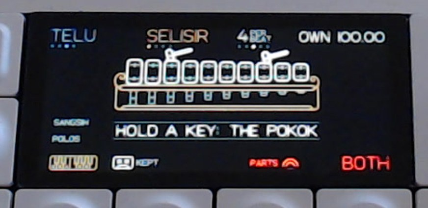
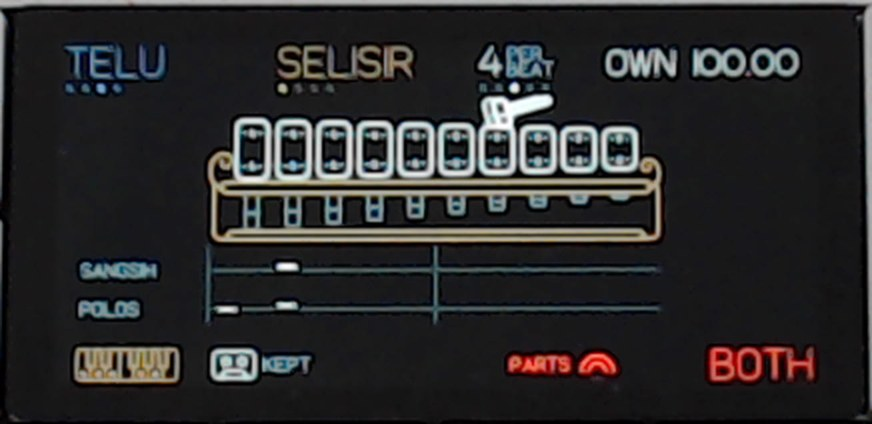

# kotekan: the guide

kotekan is a synth sequencer for the OP-1 Field, a pack for [open-field](https://github.com/LaP0573/open-field) on
OS 1.7.3 (open-field 0.12, base 30, or newer). You hold one key, the pokok, and it weaves the two interlocking parts
of Balinese kotekan around it. Polos is the lower part and sangsih the upper part. It only makes notes, so any sound
works. It is made for the gangsa engine of this repository ([its guide](gangsa.md)) with a pelog or slendro tuning
from the `tuning` pack.

This guide is for version 3. What was tried on a unit is under [On the unit](#on-the-unit); the short version is in
[the README](../README.md).



*The page with no key held: style `telu`, map `selisir`, 4 steps a beat, the unit's own clock at 100, parts `both`.
A photo of the unit's screen.*

## Playing it

1. Install `kotekan.pack` ([the README](../README.md#install) says how).
2. On the synth, open the list of sequencers. Pick `kotekan`. Pack rows come after the unit's seven, in file-name
   order: kotekan alone is row 8; with a `maqam.pack` too, kotekan is row 8 and maqam row 9. Switch it on with the
   sequencer key.
3. **Hold a key.** That key is the pokok, snapped to the nearest of the map's five keys (a tie goes down). The figure
   starts at the next step of the tape's grid (at most one step later) and runs on the unit's tempo.
4. **Move to another key**, pressing the new one before or after letting go of the old one. The new key is the next
   pokok:
   - The figure keeps its beat and heads for the new tone.
   - The new tone arrives at the start of the figure's next cycle, which is always on a tape beat. A cycle is four
     steps (two tape beats at 2 a beat, one at 4, half a beat at 8) or six steps (two beats at 3 a beat, one at 6).
   - Press the next key early in the cycle, so the style can anticipate it.
5. **Let go of every key.** Every note ends at once, and nothing hangs. If you press a new key before the next step,
   the figure carries on toward it; otherwise it stops at that step.

Each note is released one step after it starts; how long it rings after that is the sound's own. By the engine's own
figures gangsa's `saron` rings about 1.8 s after release; `gambang`, at about 0.15 s, gives a dry, damped figure.
Polos plays at your velocity and sangsih an eighth softer. When the two parts strike the same tone, it sounds as one
note (at the polos velocity: the base refuses a second note-on of a sounding note). At most three notes are held at
once (two parts and the pokok); released ones may still ring and share the synth's six voices. Keys and MIDI notes
work alike, and every MIDI note 0-127 is taken. The figure goes out over MIDI as well, on the unit's own MIDI
settings.

## The page and the knobs (while the page is up)

| Knob | Setting | Values |
| --- | --- | --- |
| blue | STYLE | nyog cag, norot, telu, empat |
| ochre (second) | MAP | selisir `c d e g a`, tembung `f g a c d`, sunaren `g a b d e`, black keys |
| grey (third) | RATE | 2, 3, 4, 6 or 8 steps to the tape's beat |
| red (fourth) | PARTS | both, polos only, sangsih only, both + pokok (the pokok struck at the start of each cycle, an octave below the held key) |

A knob stops at the ends of its list. A tape with no settings of kotekan's starts at telu, selisir, 4 steps a beat,
both.



*The page while a telu figure plays: the first notes of sangsih and polos in their lanes, and the gangsa's key being
struck.*

The page is a drawn picture, carried in the pack (`source/kotekan/kotekan-page.svg.make`). Besides the four settings
it shows:

- A gangsa with two mallets, one for each part. A mallet strikes the key of each note its part plays, and a mark on
  the instrument's rail shows the pokok.
- The two parts as lanes of dots over two cycles (8 steps, or 12 at 3 and 6 a beat), with sangsih above and polos
  below; a thin mark starts each cycle. The line in each lane is the pokok tone, and the mark under the lanes is the
  step now.
- A one-octave keyboard at the lower left, with the map's keys dotted and the pokok marked on it.
- The clock it runs on, at the top right, ending at the screen's edge: `tape 120.00`, `midi 128.50`, `own 96.00`, and
  `no clock` before the first tick after power-on.
- A hint between the lanes when there is nothing to show: `hold a key: the pokok` when no key is held,
  `no ticks: press play` when a key is held and no tick has come for half a second, `off: seq key starts it` while the
  sequencer is switched off.
- `kept`, at the bottom, once the settings are kept with the tape.

Where the picture cannot be made, the pack paints a plainer page on the base's blank page instead, with the same
settings, lanes, keyboard and clock, and longer hints.

The settings are kept **with the tape** (as `kotekan_settings`, through open-field's level 7), not with the synth
sound. A sequencer of this level has no way to know which synth slot is current, so a keep with the sound would read
and write the wrong slot's values. A tape keep is sure. So a gangsa sound does not carry the figuration, but the tape
does.

## The styles, as the computer plays them

Below, the pokok 1 2 3 2 1 1 (C D E D C C) is held at 4 steps a beat, on the map selisir, with C4 = 1. Each pokok is
pressed during the beat before it arrives. These rows were printed on a computer, by a simulation that runs the
pack's own code and writes down its note calls. On a unit the figure depends on when each key is pressed, and the
unit's notes were not compared with these rows step for step. A comma marks the octave below.

```
nyog cag
  sangsih  .  2  .  2  | .  3  .  3  | .  5  .  2  | .  3  .  1  | .  2  .  2  | .  2  .  2
  polos    1  .  3  .  | 2  .  5  .  | 3  .  3  .  | 2  .  2  .  | 1  .  3  .  | 1  .  3  .
  pokok    1, .  .  .  | 2, .  .  .  | 3, .  .  .  | 2, .  .  .  | 1, .  .  .  | 1, .  .  .

norot
  sangsih  .  2  1  .  | .  3  2  .  | .  2  3  .  | .  1  2  .  | .  2  1  .  | .  2  1  .
  polos    1  2  .  2  | 2  3  .  3  | 3  2  .  2  | 2  1  .  1  | 1  2  .  2  | 1  2  .  2
  pokok    1, .  .  .  | 2, .  .  .  | 3, .  .  .  | 2, .  .  .  | 1, .  .  .  | 1, .  .  .

telu
  sangsih  .  2  3  .  | 2  3  .  2  | 3  2  .  3  | 2  .  3  2  | .  3  2  .  | 3  2  .  3
  polos    1  2  .  1  | 2  .  1  2  | .  2  1  .  | 2  1  .  2  | 1  .  2  1  | .  2  1  .
  pokok    1, .  .  .  | 2, .  .  .  | 3, .  .  .  | 2, .  .  .  | 1, .  .  .  | 1, .  .  .

empat
  sangsih  5  .  3  5  | .  3  5  .  | 3  .  5  3  | .  5  3  .  | 5  3  .  5  | 3  .  5  3
  polos    1  2  .  1  | 2  .  1  2  | .  2  1  .  | 2  1  .  2  | 1  .  2  1  | .  2  1  .
  pokok    1, .  .  .  | 2, .  .  .  | 3, .  .  .  | 2, .  .  .  | 1, .  .  .  | 1, .  .  .
```

- **nyog cag**: a plain alternation: the two parts take turns, one tone each, along a scale-wise line. On a held
  pokok the line runs up and back (`P P+1 P+2 P+1`, or `P .. P+3 .. P+1` in six steps); on a move it heads for the new
  tone. The line moves one map step at a time inside a cycle; into the arrival it repeats the tone or moves by one or
  two. The two parts never coincide.
- **norot** (Vitale's *nyok cok*): polos `P A . A`, sangsih `. A P .`. A is the tone above the pokok, or the coming
  tone once you have pressed it. Both parts strike A in unison on step 2, three steps before the arrival. In six steps:
  polos `P A . A . A`, sangsih `. A P . P .`.
- **telu**: a cell of three adjacent tones. Polos takes the lower two, sangsih the upper two, and both strike the
  middle one (the pivot). The walk is a 3-cycle running against the 4-step cycle:
  - It turns toward the next pokok.
  - The cell moves to hold the current and next tone.
  - The walk lands on the new pokok at its arrival.
  - No part rests twice in a row.
- **empat**: the same walk over four tones with no shared tone. Polos is as in telu. Sangsih takes the upper two, and
  strikes the top tone together with polos's lowest: the kempyung, three map steps apart.

**Sourced or reconstructed:**
- The telu and empat tables come from Wikipedia's "Kotekan", which derives them from Vitale 1990 (*Balungan* 4(2)).
  The code gives the 16 steps of their pokok 1 2 3 2 example exactly (held by a test on a computer). The empat
  sangsih row was normalised: its spacing was damaged in the text as fetched.
- The rules of all four styles come from Vitale. His article was read as scanned text, and his notation figures
  could not be read.
- The **nyog cag and norot rows are reconstructions** (both six-step forms entirely), and that norot is nyok cok is
  unverified.
- The moves (how a style heads for a new tone) are **design choices**. No source gives approach figures per interval.
- Telu and empat may put a figure note up to two map steps below the held key (the sourced telu row strikes pokok 3
  as the top of its cell 1 2 3).
- Ubit-ubitan is left out: no source could be read.

The tables themselves stand at the top of the figure section of `source/kotekan/kotekan_core.h`. No gamelan player
has checked them: have one check these rows before you trust them.

## Maps, tunings and sounds

The maps are pitch-class sets, and the figure counts in map degrees, five to an octave, so it wraps across octaves.
They line up with the `tuning` pack's layouts like this:

| kotekan map | tuning pack | what you hear |
| --- | --- | --- |
| selisir `c d e g a` | `gamelan/pelog` (7 tones on the white keys from C4) | pelog selisir: tones 1 2 3 5 6 |
| tembung `f g a c d` | `gamelan/pelog` | pelog tembung: tones 4 5 6 1 2 |
| sunaren `g a b d e` | `gamelan/pelog` | pelog sunaren: tones 5 6 7 2 3 |
| selisir `c d e g a` | `gamelan/slendro` (white keys C D E G A) | slendro's five tones |
| black keys | `gamelan/gamelan` or the `black` slendro variants | slendro on the black keys |

With no tuning (12-TET), the maps are pentatonic scales. The names of the three pelog modes and their tones are from
Wikipedia's "Pelog".

With gangsa, `saron` is the classic bar and `pair` adds the beating of a paired instrument (ombak); `gambang` is the
driest. The figure holds at most three notes at once, but released notes keep ringing in their voices until a new
note takes the voice, so all six may be busy.

**Recordings** (in `media/`, made on the unit with version 3, gangsa's sounds and the `tuning` pack on gamelan / slendro):

| Recording | What it shows |
| --- | --- |
| [Four styles](../media/kotekan-01-four-styles.mp3) | One held line (C D E G E D C) in nyog cag, norot, telu, empat; `saron`, 4 steps a beat |
| [A pokok line woven](../media/kotekan-02-a-pokok-line-woven.mp3) | A longer line with the pokok struck too: telu, then empat; `pair` |
| [Five rates](../media/kotekan-03-five-rates.mp3) | The same line at 2, 3, 4, 6 and 8 steps a beat; `gambang`, nyog cag |

They were played over MIDI by a script and recorded from the unit's USB audio; each file's peak was brought to
-1 dBFS and nothing else was done to the sound.

## Rate and the clock

RATE is how many steps fall in one of the tape's beats, from the sequencer's 96 pulses a quarter: 48, 32, 24, 16 or
12 pulses a step. The figure's cycle is four steps at 2, 4 and 8 (two beats, one, half of one) and six steps at 3 and
6 (two beats, one), so the pokok always arrives on a tape beat (at 8, on a beat or its half).

**The grid.** The steps are on the tape's grid. Each tick carries `pulse`, the firmware's count 0-47 (an eighth),
set back to 0 when the tape starts. **That count starts where play is pressed**: the play key sets it to 0 at every
press, and it then follows the tape's motion; the metronome and the tape's bar lines go by the tape's position
instead. So "a tape beat" in this guide is the firmware's count: it falls on the metronome's click and on the bar
lines only when play was pressed with the tape standing on a beat line (the tape's start, or after a jump to a bar).
Started in the middle of a beat, every step is off the click by that much for as long as the tape runs, and pressing
play again moves the grid again. The pack is handed only the count and cannot do otherwise; the stock sequencers are
no different.

kotekan counts the wraps of `pulse`, so it knows where it is in four beats, and steps wherever that phase is a
multiple of the step's pulses. A key pressed between steps waits for the next one. A rate change takes the new rate's
grid at once. When the tape starts (the clock turns to `tape`) or the count goes back, the grid starts again at that
pulse. One limit: `pulse` gives the eighth but not which half of the beat. If you switch kotekan on while the tape is
already playing, its cycles may start on the off-eighth until the tape is next started. Press play (or stop and
play) once to lock it. If `pulse` stands still, the count keeps time.

With the tape stopped, the sequencer still ticks on the unit's own clock, and the page says `own` and the tempo; on
the unit it read `OWN 100.00`. If no tick comes while a key is held, the page says `no ticks: press play`. Letting go
always ends the notes at once, ticks or not.

## Limits

- Synth only. It does not run while the unit is on the drum, because only the current instrument ticks.
- The octave keys move only keys pressed afterwards, not the figure already playing.
- Notes stay inside 0-127. A step whose note would pass 127 rests.
- Ubit-ubitan, angsel breaks, and the cross-rhythm variants are not there.
- With `+pokok`, a figure note that is the very note the bass is ringing on is not struck again (the note is
  already sounding): that step is silent. It happens when the next key is an octave from the one before (hold C4,
  then press C3: two steps of that cycle rest). Nothing hangs. This is known and was left as it is.
- After a sound has been loaded with a key held, the steps the unit skipped during the load all come at once (the
  unit's own sequencers do the same).
- With kotekan beside other sequencer packs the sequencer list has more than eight rows. On the test unit kotekan
  was picked from the list with one other sequencer pack, maqam, installed; other sets were not tried.
- The settings go with the tape, not with the synth sound.

## On the unit

kotekan was tried on 2026-11-25 on an OP-1 Field with OS 1.7.3 and open-field 0.19 (base 37), beside 15 other packs.
Later the same day the unit was moved to open-field 0.21 (base 39): the pack starts there too, its picture is made
and the log holds no trouble line. The tests were run by remote control over USB: keys and knobs sent as MIDI, the
unit's log, its USB audio, and a webcam on the screen.

**Version 2** (the drawn page; its note code is version 3's):

- It was picked from the sequencer list, and its page is drawn, also with `+POKOK`.
- All four styles ran. Every note was one of the map's five tones and on the step grid. No note was refused, none
  came late, and the synth was silent when the keys were let go.
- The notes were not compared step for step with the rows above: that depends on when each key is pressed.
- Its hint was cut on the screen: `HOLD A KEY: THE POK`.

**Version 3** (the page's texts only):

- It starts with no trouble line in the log, and its picture is made.
- Seen whole through the webcam: `HOLD A KEY: THE POKOK`; `OFF: SEQ KEY STARTS IT`, under the unit's own `SEQ OFF`
  notice; `OWN 100.00` and `TAPE 100.00` at the right. The two photos in this guide are from that webcam.

**Not tried**: the figures step for step, as said. The tests judged nothing by ear: the recordings were checked by
level, length and pitch.

## Versions

| Version | What |
| --- | --- |
| 1 | A page painted on the base's blank page. Ran on a unit on 2026-11-23 |
| 2 | The page as a drawn picture; the same note code. Ran on a unit on 2026-11-25: all four styles played, and its hint was cut on the screen |
| 3 | The page's texts only (2026-11-25): the hints stand centred between the lanes, the clock's word ends at the right edge, and `no clock yet` reads `no clock`. Seen whole on the unit the same day |

## The source

| File in `source/kotekan/` | What |
| --- | --- |
| `kotekan_core.h` | The logic: the maps, the styles' tables, the figure, the grid, the keys held and the notes sounding. It calls nothing; no library, no division, no floating point |
| `kotekan.cpp` | The pack: it takes the keys and the ticks from the base, makes the note calls the core decides, keeps the settings with the tape, and shows the page |
| `recipe.json` | The pack's name and version, its sources, and its card: a sequencer for the synth that takes every MIDI note, and the settings kept with the tape |
| `kotekan-page.svg.make` | The page's picture, in the form open-field's pack tool takes |
| `kotekan_card.s`, `kotekan_pictures.s` | The card and the directory of the pictures, made from the recipe by open-field's pack tool. Do not edit them |

How to build the pack from these is in [the README](../README.md#build). Some comments in the source name notes and
test files of the working folder the pack was written in; those files are not in this repository. The comment at the
top of `kotekan.cpp` that says nothing there has run on a unit is from before the tests above.

Unofficial; not made, endorsed or supported by Teenage Engineering. MIT licence.
